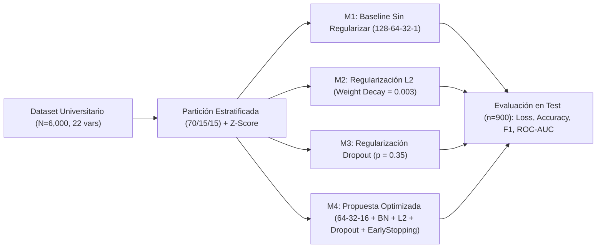

# Plan Maestro de Acción: Artículo Científico de Aplicación de Redes Neuronales

**Curso:** Inteligencia Artificial  
**Institución:** Universidad Peruana Unión (UPeU) - Campus Juliaca  
**Docente:** Mg. Angel Rosendo Condori Coaquira  
**Autor:** William David Ortiz Mamani (`william.ortiz@upeu.edu.pe` | GitHub: `302xdwill`)  
**Título del Artículo:** *Predicción Temprana de la Deserción Estudiantil Universitaria mediante Redes Neuronales Profundas con Regularización L2, Dropout y Batch Normalization*  
**Directorio de Trabajo:** `D:\Documentos\Trabajos upeu\UPEU\Inteligencia Artificial\Articulo`  

---

## 1. Requerimientos Oficiales del Trabajo

* **Objetivo:** Elaborar un borrador de artículo científico aplicando **Redes Neuronales Artificiales** en la solución de un problema o necesidad real.
* **Estructura Obligatoria del Artículo (Formato IMRyD):**
  1. **Título** (En español e inglés)
  2. **Resumen / Abstract** (150–250 palabras sintetizando problema, método, resultados y conclusión)
  3. **Palabras Clave / Keywords** (6 términos técnicos indexables)
  4. **I. Introducción** (Contexto de la deserción universitaria, estado del arte, justificación e hipótesis/objetivo)
  5. **II. Materiales y Métodos (Metodología)** (Descripción del dataset, preprocesamiento Z-score, arquitecturas evaluadas, técnicas de regularización y métricas)
  6. **III. Resultados y Discusión** (Curvas de pérdida/exactitud, tablas comparativas de los 4 modelos, matriz de confusión, curva ROC-AUC e importancia de variables)
  7. **IV. Conclusiones** (Hallazgos cuantitativos, impacto en Tutoría Universitaria y trabajos futuros)
  8. **Referencias Bibliográficas** (Formato IEEE)
* **Entregables:**
  * Documento final en **formato PDF** (`manuscript/entregas_pdf/Articulo_Redes_Neuronales_William_Ortiz.pdf`).
  * **Sustentación en vivo** del código fuente (`notebooks/Experimento_Redes_Neuronales_Desercion.ipynb` y módulos en `src/`) y de los resultados obtenidos.

---

## 2. Dataset Seleccionado y Dimensiones de Estudio

Se emplea el repositorio multimodal **`final_student_dataset.csv`** junto con su diccionario técnico oficial (**`data_dictionary.csv`**), seleccionando una cohorte estratificada de **$N = 6,000$ estudiantes universitarios** sin valores perdidos (0.0% nulos) y **22 variables predictoras ($X$)** agrupadas en 6 dimensiones reales para predecir la variable binaria **`at_risk` ($Y \in \{0, 1\}$)**:

1. **Demografía y Nivel Socioeconómico:** `age`, `gender_encoded`, `international_student`, `first_generation`, `socioeconomic_deprivation_index`.
2. **Estado Financiero Universitario:** `scholarship_holder` (becado), `tuition_up_to_date` (pensiones al día).
3. **Historial Académico Previo:** `admission_grade`, `prior_qualification_grade`.
4. **Rendimiento Académico Universitario:** `gpa_score_avg`, `gpa_score_trend`, `pass_rate`, `first_assessment_score`, `study_hours_per_week`, `study_load`.
5. **Compromiso Conductual en Plataforma Virtual (LMS / VLE):** `attendance_rate`, `lms_engagement_score`, `lms_active_days_ratio`, `longest_inactivity_gap_days`, `missed_submissions_count`.
6. **Factores Psicológicos y Fisiológicos:** `stress_level_scale` (nivel de estrés 1–10), `sleep_hours_per_day` (horas de sueño diarias).

---

## 3. Arquitectura Ordenada del Proyecto en Disco

```
Articulo/
├── data/
│   ├── raw/
│   │   ├── final_student_dataset.csv           # Dataset fuente multimodal
│   │   └── data_dictionary.csv                 # Diccionario oficial de las variables
│   └── processed/
│       ├── X_train.npy, y_train.npy            # Entrenamiento (70% = 4,200 alumnos)
│       ├── X_val.npy, y_val.npy                # Validación (15% = 900 alumnos)
│       ├── X_test.npy, y_test.npy              # Prueba ciega (15% = 900 alumnos)
│       └── metadata.json                       # Parámetros del escalador Z-score
├── notebooks/
│   └── Experimento_Redes_Neuronales_Desercion.ipynb  # Cuaderno Jupyter ejecutado para sustentación
├── src/
│   ├── preprocessing.py                        # Extracción, partición estratificada y Z-score
│   ├── model_architectures.py                  # Definición de las 4 arquitecturas en Keras
│   ├── train.py                                # Entrenamiento comparativo y EarlyStopping
│   ├── evaluate.py                             # Generación de las 4 figuras científicas (300 DPI)
│   └── build_pdf.py                            # Maquetación y compilación del artículo a PDF
├── models/
│   └── mejor_modelo_desercion.keras            # Pesos óptimos guardados del Modelo 4
├── results/
│   ├── figures/
│   │   ├── fig1_exploracion_dataset.png        # Partición estratificada y correlaciones de Pearson
│   │   ├── fig2_curvas_aprendizaje_overfitting.png # Mitigación del overfitting (4 modelos)
│   │   ├── fig3_matriz_confusion_roc.png       # Matriz de confusión y curvas ROC-AUC
│   │   └── fig4_importancia_variables.png      # Importancia de variables por permutación
│   └── tables/
│       ├── comparativa_modelos.csv             # Tabla resumen de métricas (Loss, Acc, F1, AUC)
│       └── metricas_detalladas.json            # Historiales completos por época
├── manuscript/
│   ├── borrador_articulo.md                    # Manuscrito científico completo en Markdown
│   ├── articulo_cientifico.html                # Maquetación académica tipo IEEE/Paper
│   └── entregas_pdf/
│       └── Articulo_Redes_Neuronales_William_Ortiz.pdf # Entregable final en PDF
└── Plan_De_Accion_Articulo.md                  # Este documento maestro
```

---

## 4. Diseño Experimental (Estudio Ablativo de 4 Redes Neuronales)


