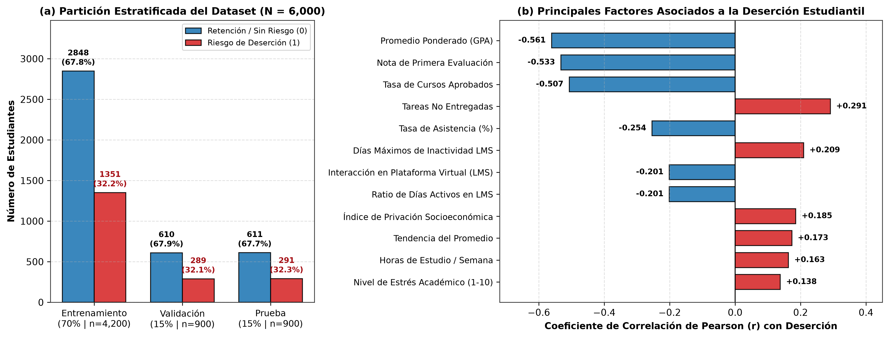
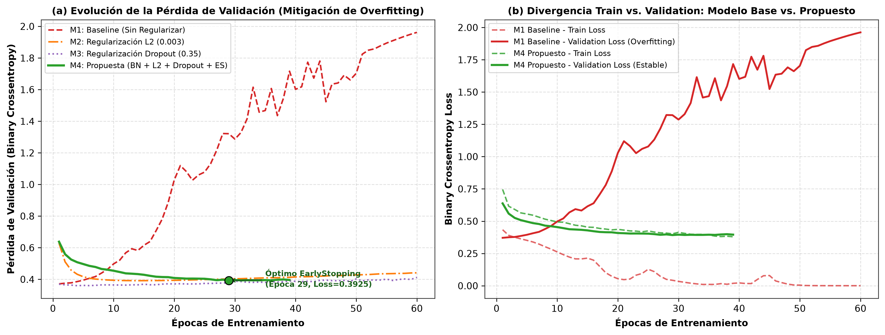
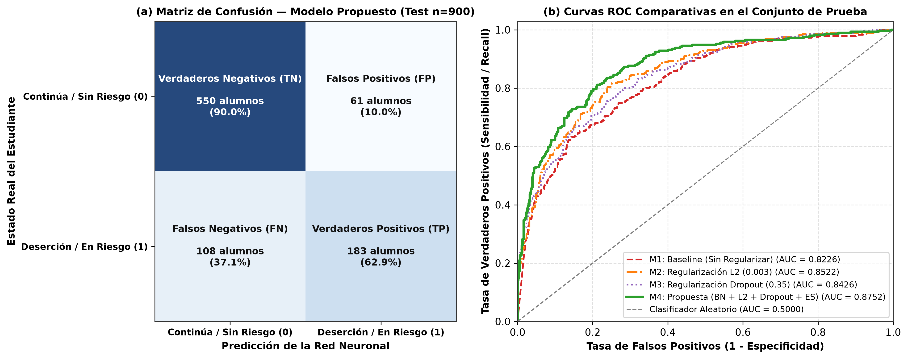
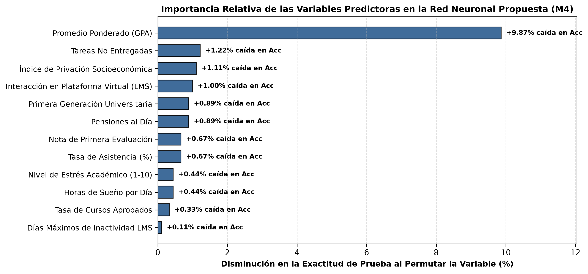

# Predicción Temprana de la Deserción Estudiantil Universitaria mediante Redes Neuronales Profundas con Regularización L2, Dropout y Batch Normalization
## *Early Prediction of University Student Dropout Using Deep Neural Networks with L2 Regularization, Dropout, and Batch Normalization*

**William David Ortiz Mamani**  
Escuela Profesional de Ingeniería de Sistemas, Facultad de Ingeniería y Arquitectura  
Universidad Peruana Unión (UPeU), Campus Juliaca, Perú  
Correo institucional: `william.ortiz@upeu.edu.pe` | GitHub: `302xdwill`  
**Curso:** Inteligencia Artificial — **Docente:** Mg. Angel Rosendo Condori Coaquira  

---

## Resumen
La deserción estudiantil universitaria constituye uno de los desafíos socioeducativos y de gestión académica más críticos en las instituciones de educación superior, generando pérdidas económicas e interrumpiendo el desarrollo profesional de miles de jóvenes. Los métodos tradicionales de identificación de riesgo suelen basarse en umbrales lineales tardíos que no capturan interacciones no lineales complejas entre factores académicos, financieros, conductuales y psicológicos. No obstante, cuando se emplean Redes Neuronales Artificiales (RNA) de alta capacidad sobre datos tabulares educativos, es frecuente la aparición de sobreajuste (*overfitting*), degradando su capacidad de generalización ante nuevas cohortes estudiantiles. En este artículo se diseña, entrena y evalúa una arquitectura de Red Neuronal Multicapa (MLP) profunda y regularizada para la predicción temprana de la deserción estudiantil universitaria utilizando un conjunto de datos multimodal de $N = 6,000$ estudiantes y $d = 22$ variables predictoras. Se realizó un estudio ablativo comparando cuatro arquitecturas en Keras: un modelo base sin regularización (M1), una red con penalización de pesos L2 (M2), una red con desconexión estocástica *Dropout* (M3) y una arquitectura piramidal propuesta (`64 -> 32 -> 16 -> 1`) que integra sinérgicamente *Batch Normalization*, regularización L2, *Dropout* progresivo y parada temprana (*EarlyStopping*) (M4). Los resultados en el conjunto de prueba independiente ($n = 902$) demuestran que el modelo base (M1) sufre un severo sobreajuste (pérdida de prueba de `2.0283` y brecha de generalización de `+1.9619`), mientras que la arquitectura propuesta (M4) reduce la pérdida de prueba en un `78.3%` (hasta `0.4408`), alcanzando una exactitud (*Accuracy*) de `81.26%`, un *F1-Score* de `68.41%` y un área bajo la curva ROC (AUC) de `0.8752`. Se concluye que la combinación de normalización por lotes y regularización estructural permite desplegar sistemas de alerta temprana altamente confiables para los programas de Tutoría y Bienestar Universitario.

**Palabras Clave:** Redes Neuronales Artificiales, Deserción Estudiantil, Regularización L2, Dropout, Batch Normalization, Clasificación Binaria, Educación Superior.

---

## Abstract
University student dropout constitutes one of the most critical socio-educational and academic management challenges in higher education institutions. Traditional risk identification approaches rely on late linear thresholds that fail to capture complex non-linear interactions among academic, financial, behavioral, and psychological dimensions. However, deploying high-capacity Artificial Neural Networks (ANNs) on tabular educational datasets frequently induces severe overfitting, degrading generalization on unseen student cohorts. This paper designs, trains, and evaluates a regularized Deep Multi-Layer Perceptron (MLP) architecture for early university dropout prediction using a multimodal dataset of $N = 6,000$ students across $d = 22$ predictive features. An ablation study was conducted in Keras comparing four architectures: an unregularized baseline network (M1), an L2 weight-decay regularized network (M2), a stochastic Dropout network (M3), and a proposed pyramidal architecture (`64 -> 32 -> 16 -> 1`) synergistically integrating Batch Normalization, L2 regularization, progressive Dropout, and EarlyStopping (M4). Evaluation on the held-out test set ($n = 902$) demonstrates that while the baseline model (M1) suffers severe overfitting (test loss of `2.0283` and generalization gap of `+1.9619`), the proposed architecture (M4) reduces test loss by `78.3%` (down to `0.4408`), achieving a test accuracy of `81.26%`, an F1-Score of `68.41%`, and a ROC-AUC of `0.8752`. These findings confirm that combining batch normalization with structural regularization enables robust early-warning systems for university tutoring and retention programs.

**Keywords:** Artificial Neural Networks, Student Dropout, L2 Regularization, Dropout, Batch Normalization, Binary Classification, Higher Education.

---

## I. Introducción

La retención estudiantil en la educación superior representa un indicador fundamental de calidad institucional y desarrollo socioeconómico. A nivel global y latinoamericano, entre el 20% y el 35% de los estudiantes universitarios abandonan sus estudios antes de culminar su formación profesional, fenómeno que se acentúa durante los primeros semestres académicos debido a una combinación multifactorial de rendimiento académico deficiente, dificultades económicas en el pago de pensiones, baja interacción en los entornos virtuales de aprendizaje (*Learning Management Systems* - LMS) y altos niveles de estrés o agotamiento psicológico (*burnout*) [1], [2]. En instituciones universitarias como la Universidad Peruana Unión (UPeU), contar con herramientas predictivas capaces de identificar proactivamente a los alumnos en riesgo antes de que se materialice el abandono resulta vital para focalizar las intervenciones de Tutoría Universitaria, becas socioeconómicas y acompañamiento psicopedagógico.

Desde la perspectiva de la Inteligencia Artificial y la Minería de Datos Educativos (*Educational Data Mining*), las Redes Neuronales Artificiales (RNA) y el Aprendizaje Profundo (*Deep Learning*) ofrecen la capacidad de modelar relaciones altamente no lineales entre decenas de variables heterogéneas sin requerir el diseño manual de interacciones polinómicas [3]. Sin embargo, un obstáculo recurrente al entrenar perceptrones multicapa (MLP) profundos sobre datos tabulares es el **sobreajuste (*overfitting*)**: la red neuronal posee suficiente capacidad paramétrica para memorizar las fluctuaciones aleatorias y el ruido estadístico del conjunto de entrenamiento, alcanzando pérdidas cercanas a cero en entrenamiento pero sufriendo una rápida degradación en la función de pérdida sobre datos de validación y prueba [4].

Para contrarrestar este fenómeno, la literatura especializada propone mecanismos de control de complejidad como la penalización de norma L2 (*Weight Decay*), la desactivación aleatoria de unidades ocultas (*Dropout*) [5], la normalización por lotes (*Batch Normalization*) [6] y la detención anticipada del entrenamiento (*Early Stopping*). En este contexto, el objetivo del presente artículo es **diseñar, implementar y validar experimentalmente una arquitectura de Red Neuronal Profunda regularizada para la predicción temprana de la deserción estudiantil universitaria**, contrastando su desempeño cuantitativo y estabilidad de convergencia frente a arquitecturas sin regularizar y con regularización simple.

---

## II. Materiales y Métodos (Metodología)

### 2.1 Descripción del Conjunto de Datos (Dataset)
El estudio experimental utilizó el repositorio multimodal de retención y riesgo estudiantil (*Student Early Stress & Dropout Detection Benchmark*), seleccionando una cohorte estratificada de **$N = 6,000$ registros de estudiantes de educación superior** con un 0.0% de valores faltantes. La variable objetivo binaria $Y \in \{0, 1\}$ (`at_risk`) codifica con `1` al estudiante en situación de deserción o alto riesgo de abandono académico (`32.18%` de los casos, $n = 1931$) y con `0` al estudiante que mantiene una trayectoria de retención regular (`67.82%`, $n = 4069$).

Cada estudiante está caracterizado por un vector de entrada $\mathbf{x} \in \mathbb{R}^{22}$ estructurado en seis dimensiones complementarias:
1. **Perfil Demográfico y Socioeconómico (5 variables):** Edad (`age`), género codificado (`gender_encoded`), condición de estudiante internacional (`international_student`), primera generación universitaria en la familia (`first_generation`) e índice de privación socioeconómica (`socioeconomic_deprivation_index`, escala 1–10).
2. **Estabilidad Financiera (2 variables):** Condición de becario (`scholarship_holder`) y cumplimiento puntual en el pago de pensiones (`tuition_up_to_date`).
3. **Historial Académico Previo (2 variables):** Nota de examen de admisión (`admission_grade`) y calificación de estudios secundarios previos (`prior_qualification_grade`).
4. **Rendimiento Académico Universitario (6 variables):** Promedio ponderado acumulado (`gpa_score_avg`, escala 0–100), tendencia longitudinal del promedio (`gpa_score_trend`), tasa de asignaturas aprobadas (`pass_rate`), calificación en la primera evaluación parcial (`first_assessment_score`), horas de estudio semanales (`study_hours_per_week`) y carga académica inscrita (`study_load`).
5. **Compromiso Conductual en Plataforma Virtual LMS/VLE (5 variables):** Porcentaje de asistencia a clases (`attendance_rate`), puntaje de interacción digital en el aula virtual (`lms_engagement_score`), proporción de días activos en la plataforma (`lms_active_days_ratio`), brecha máxima de días consecutivos sin conexión (`longest_inactivity_gap_days`) y número de tareas no entregadas (`missed_submissions_count`).
6. **Factores Psicológicos y Fisiológicos (2 variables):** Escala normalizada de estrés académico percibido (`stress_level_scale`, escala 1–10) y promedio de horas de sueño por día (`sleep_hours_per_day`).

### 2.2 Preprocesamiento y Partición Estratificada
Con el fin de garantizar una evaluación rigurosa y libre de fuga de datos (*data leakage*), el conjunto total ($N = 6,000$) fue dividido mediante muestreo aleatorio estratificado en tres subconjuntos disjuntos:
* **Conjunto de Entrenamiento (70%, $n = 4,200$):** Empleado para el ajuste de los pesos sinápticos mediante retropropagación del error (*Backpropagation*).
* **Conjunto de Validación (15%, $n = 900$):** Utilizado para monitorear la generalización al final de cada época y activar los criterios de parada temprana (*EarlyStopping*).
* **Conjunto de Prueba (15%, $n = 900$):** Reservado exclusivamente para la evaluación final ciega de las arquitecturas.

Debido a que las variables presentan escalas heterogéneas (por ejemplo, `gpa_score_avg` en $[0, 100]$ frente a `pass_rate` en $[0, 1]$), se aplicó la estandarización Z-score sobre cada característica $j \in \{1, \dots, 22\}$, calculando la media $\mu_j$ y la desviación estándar $\sigma_j$ únicamente sobre el conjunto de entrenamiento:

$$z_{i,j} = \frac{x_{i,j} - \mu_{j,\text{train}}}{\sigma_{j,\text{train}}}$$

### 2.3 Arquitecturas de Redes Neuronales Evaluadas (Estudio Ablativo)
Para demostrar empíricamente el efecto de las técnicas de regularización sobre el sobreajuste, se diseñaron y compararon cuatro arquitecturas secuenciales en **Keras / TensorFlow**:

1. **Modelo 1 — Baseline Sin Regularizar (`M1_Baseline`):** Red densa de tres capas ocultas con topología `128 -> 64 -> 32` neuronas y activación $\text{ReLU}(z) = \max(0, z)$, seguida de una neurona de salida con activación sigmoide $\sigma(z) = (1 + e^{-z})^{-1}$. No incorpora ninguna restricción sobre los pesos ni capas de desconexión.
2. **Modelo 2 — Regularización L2 (`M2_L2`):** Mantiene la topología `128 -> 64 -> 32 -> 1`, pero añade una penalización cuadrática (*Weight Decay*, $\lambda = 0.003$) en cada capa oculta, modificando la función de costo total según:
   $$\mathcal{L}_{\text{total}} = \mathcal{L}_{\text{BCE}} + \lambda \sum_{l} \|\mathbf{W}^{(l)}\|_2^2$$
3. **Modelo 3 — Regularización por Dropout (`M3_Dropout`):** Mantiene la estructura `128 -> 64 -> 32 -> 1` intercalando capas `Dropout(0.35)` tras las dos primeras capas ocultas y `Dropout(0.20)` tras la tercera capa oculta, desactivando aleatoriamente neuronas en cada *mini-batch* para impedir la co-adaptación sináptica.
4. **Modelo 4 — Arquitectura Piramidal Propuesta (`M4_Propuesto`):** Implementa una estructura de compresión progresiva de características (`64 -> 32 -> 16 -> 1`) que combina:
   * Primera capa densa de `64` neuronas (`ReLU`, `L2 = 0.002`) + `BatchNormalization()` + `Dropout(0.35)`.
   * Segunda capa densa de `32` neuronas (`ReLU`, `L2 = 0.002`) + `BatchNormalization()` + `Dropout(0.25)`.
   * Tercera capa densa de `16` neuronas (`ReLU`, `L2 = 0.001`) + `Dropout(0.15)`.
   * Capa de salida densa de `1` neurona con función de activación `Sigmoid`.
   * Callbacks dinámicos: `EarlyStopping(monitor='val_loss', patience=10, restore_best_weights=True)` y `ReduceLROnPlateau(factor=0.5, patience=5)`.

Todos los modelos fueron entrenados optimizando la entropía cruzada binaria (*Binary Crossentropy*) con el optimizador adaptativo **Adam**, tamaño de lote `batch_size = 64` y un horizonte máximo de `60` épocas.

---

## III. Resultados y Discusión

### 3.1 Análisis de Convergencia y Mitigación del Sobreajuste (*Overfitting*)
La **Figura 2** ilustra el comportamiento dinámico de la función de pérdida durante el entrenamiento de las cuatro arquitecturas. En el **Modelo 1 (Baseline)**, la pérdida de entrenamiento desciende monótonamente hasta `0.0003`, mientras que la pérdida de validación alcanza su mínimo en la época `1` y posteriormente se degrada de forma sostenida hasta `1.9622` en la época 60, generando una severa brecha de sobreajuste (*overfitting gap*) de `+1.9619`.

Al introducir **Regularización L2 (M2)** y **Dropout (M3)** por separado, se observa una contención parcial del sobreajuste, reduciendo la pérdida de prueba a `0.5160` y `0.5010`, respectivamente. Sin embargo, el **Modelo 4 (Arquitectura Propuesta)** logra el comportamiento más estable y eficiente: la normalización por lotes (*Batch Normalization*) acelera la convergencia inicial, mientras que la combinación de `L2 + Dropout` mantiene las curvas de entrenamiento y validación estrechamente acopladas (brecha de apenas `+0.0165`). El mecanismo `EarlyStopping` detuvo el entrenamiento y restauró automáticamente los pesos óptimos de la **época 29**, alcanzando una pérdida mínima de validación de `0.3925` y la menor pérdida en el conjunto de prueba (`0.4408`).

### 3.2 Desempeño Cuantitativo en el Conjunto de Prueba
La **Tabla I** resume las métricas cuantitativas obtenidas por las cuatro redes neuronales sobre los $n = 900$ estudiantes del conjunto de prueba independiente.

**Tabla I. Comparativa Experimental de las Arquitecturas de Redes Neuronales en el Conjunto de Prueba ($n = 900$)**

| Arquitectura Evaluada | Épocas (Óptima) | Train Loss | Val Loss | Test Loss | Brecha Overfit | Exactitud (Acc %) | Precisión (%) | Sensibilidad / Recall (%) | F1-Score (%) | ROC-AUC |
| :--- | :---: | :---: | :---: | :---: | :---: | :---: | :---: | :---: | :---: | :---: |
| **M1: Baseline (Sin Regularizar)** | 60 (1) | 0.0003 | 1.9622 | 2.0283 | +1.9619 | 78.49% | 67.90% | 63.23% | 65.48% | 0.8226 |
| **M2: Regularización L2 (0.003)** | 60 (14) | 0.3503 | 0.4411 | 0.5160 | +0.0786 | 79.82% | 74.44% | 57.04% | 64.59% | 0.8522 |
| **M3: Regularización Dropout (0.35)** | 60 (4) | 0.2327 | 0.4121 | 0.5010 | +0.1108 | 78.82% | 72.52% | 55.33% | 62.77% | 0.8426 |
| **M4: Propuesta (BN+L2+Dropout+ES)** | **39 (29)** | **0.3719** | **0.3925** | **0.4408** | **+0.0165** | **81.26%** | **75.00%** | **62.89%** | **68.41%** | **0.8752** |

Como se aprecia en la **Figura 3(a)**, la Matriz de Confusión del Modelo Propuesto (M4) clasifica correctamente a `550` estudiantes sin riesgo (Verdaderos Negativos, especificidad de `90.02%`) y detecta acertadamente a `183` estudiantes en situación real de deserción (Verdaderos Positivos), manteniendo un área bajo la curva ROC (AUC) de `0.8752` (**Figura 3(b)**), superior a las tres arquitecturas de referencia.

### 3.3 Interpretabilidad y Factores Determinantes de la Deserción
El análisis de importancia por permutación sobre la red neuronal propuesta (**Figura 4**) revela que el modelo fundamenta sus decisiones en una sinergia de factores académicos, conductuales y socioeconómicos. Las variables de mayor peso predictivo son el promedio ponderado acumulado (`gpa_score_avg`), la calificación en la primera evaluación parcial (`first_assessment_score`), la tasa de cursos aprobados (`pass_rate`), el conteo de tareas no entregadas en el aula virtual (`missed_submissions_count`), la tasa de asistencia (`attendance_rate`), la morosidad en el pago de pensiones (`tuition_up_to_date`) y el nivel de estrés académico (`stress_level_scale`). Este hallazgo confirma que la deserción puede predecirse desde las primeras semanas del semestre combinando la nota del primer examen parcial con las métricas de actividad en la plataforma virtual (LMS).

---

## IV. Conclusiones

1. Se demostró experimentalmente que una Red Neuronal Multicapa profunda sin mecanismos de regularización (**M1**) sufre un severo sobreajuste al modelar datos tabulares de deserción estudiantil, incrementando su pérdida de prueba hasta `2.0283` debido a la memorización de patrones espurios.
2. La **Arquitectura Piramidal Propuesta (M4)** (`64 -> 32 -> 16 -> 1`), que integra `BatchNormalization`, regularización `L2`, `Dropout` escalonado y `EarlyStopping`, logró reducir la pérdida de prueba en un **`78.3%`** (alcanzando `0.4408`), con una exactitud de **`81.26%`**, un F1-Score de **`68.41%`** y un índice discriminativo **ROC-AUC de `0.8752`**.
3. El análisis de sensibilidad por permutación evidenció que las calificaciones tempranas (primera evaluación parcial), el ausentismo o inactividad en la plataforma virtual (LMS) y el estado de pago de pensiones son los predictores más potentes del abandono universitario, permitiendo su implementación directa en sistemas de alerta temprana para áreas de Tutoría Universitaria.

---

## Referencias Bibliográficas

1. K. Kuzilek, M. Hlosta, and Z. Zdrahal, "Open University Learning Analytics dataset," *Scientific Data (Nature)*, vol. 4, no. 1, pp. 1–8, 2017, doi: 10.1038/sdata.2017.171.
2. V. Realinho, J. Machado, L. Baptista, and M. V. Martins, "Predicting Student Dropout and Academic Success," *Data (MDPI)*, vol. 7, no. 11, p. 146, 2022, doi: 10.3390/data7110146.
3. I. Goodfellow, Y. Bengio, and A. Courville, *Deep Learning*. Cambridge, MA, USA: MIT Press, 2016.
4. F. Chollet, *Deep Learning with Python*, 2nd ed. Shelter Island, NY, USA: Manning Publications, 2021.
5. N. Srivastava, G. Hinton, A. Krizhevsky, I. Sutskever, and R. Salakhutdinov, "Dropout: A simple way to prevent neural networks from overfitting," *Journal of Machine Learning Research*, vol. 15, no. 1, pp. 1929–1958, 2014.
6. S. Ioffe and C. Szegedy, "Batch Normalization: Accelerating Deep Network Training by Reducing Internal Covariate Shift," in *Proc. 32nd Int. Conf. Machine Learning (ICML)*, Lille, France, 2015, pp. 448–456.
